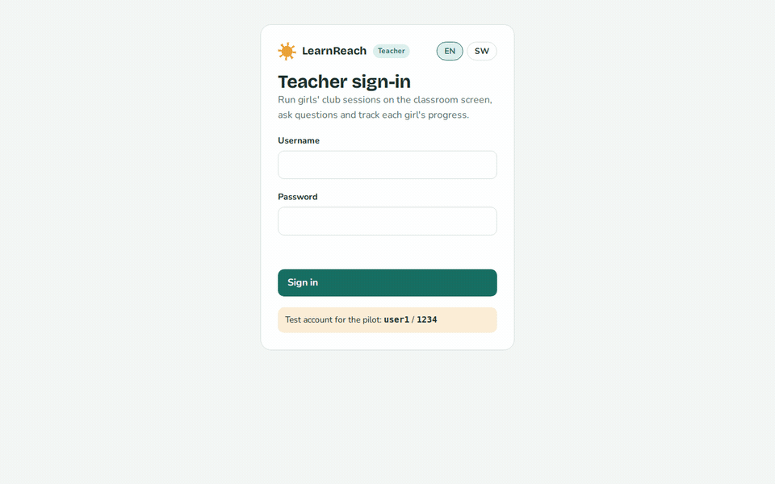
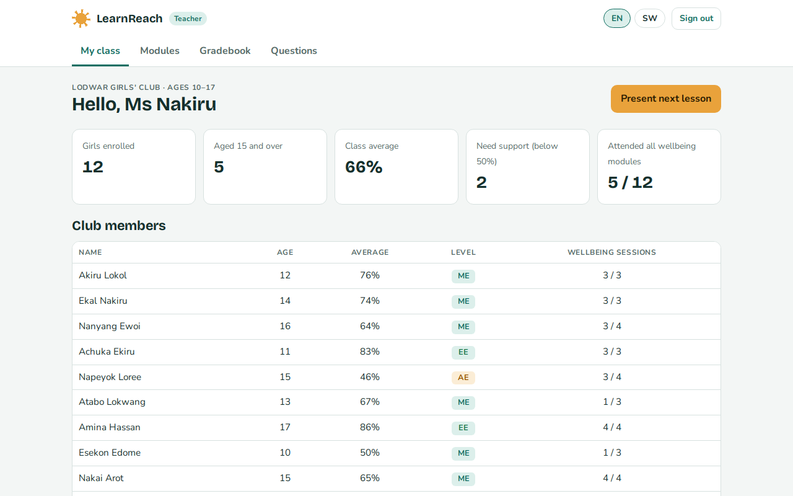
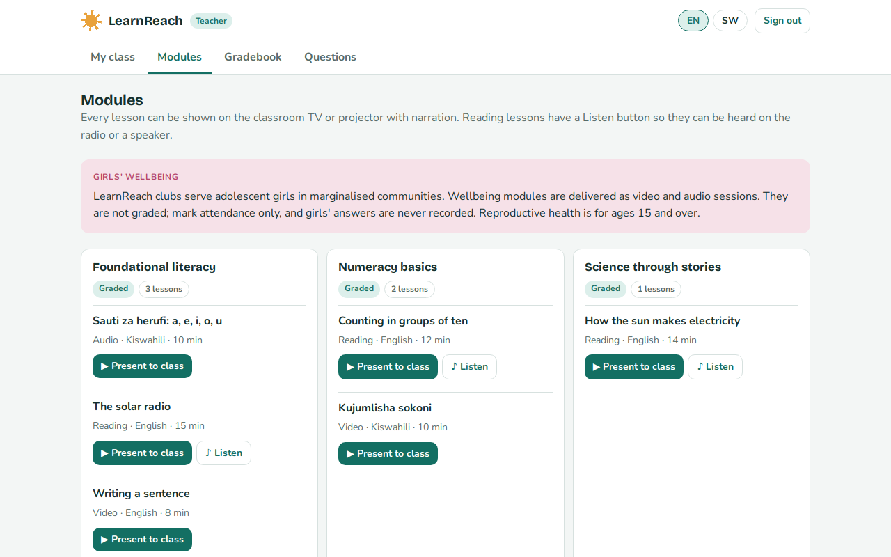
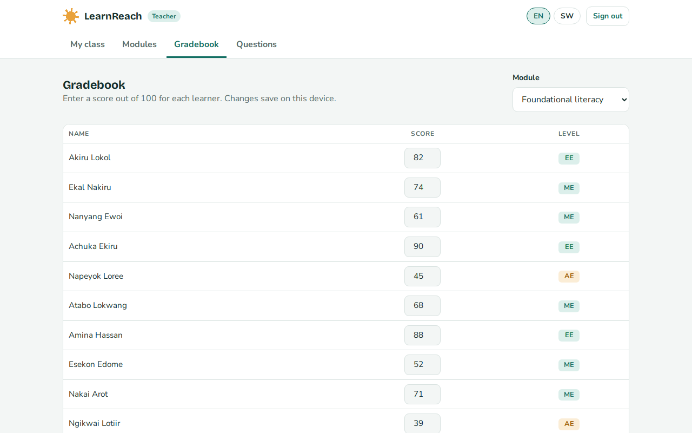
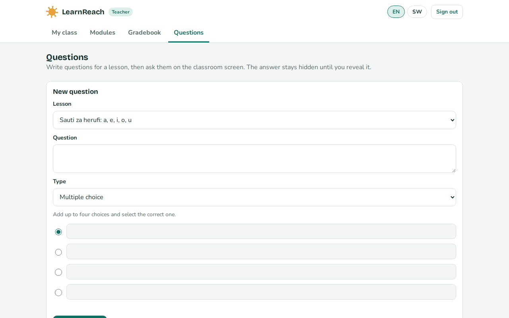
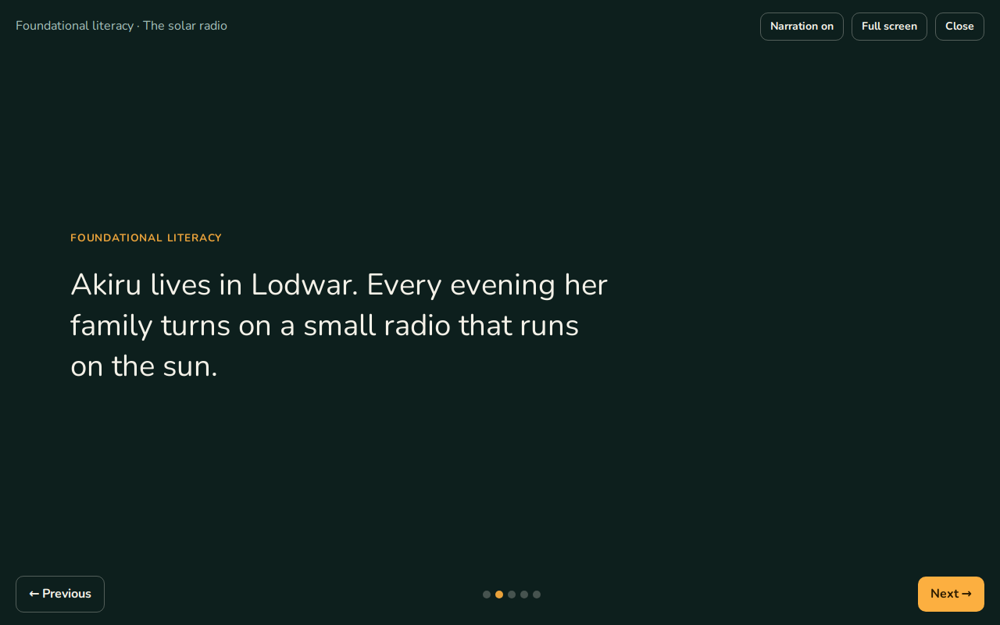
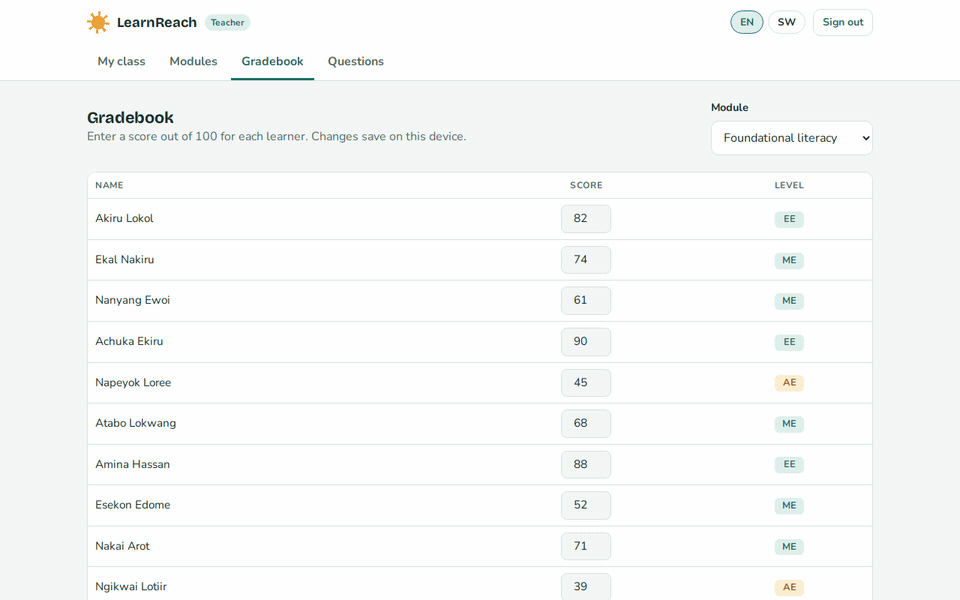
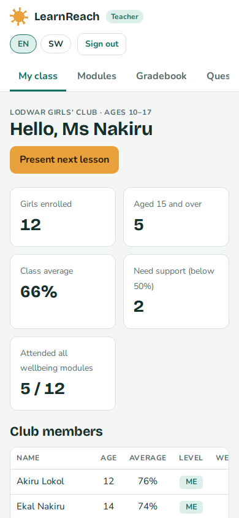
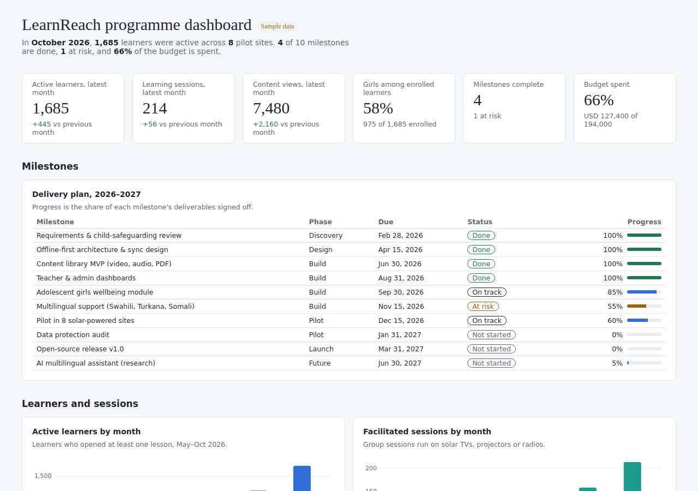

# LearnReach

[](https://github.com/hellenalianya-code/learn/actions/workflows/ci.yml)
[](https://hellenalianya-code.github.io/learn/)
[](LICENSE)

**Offline-first, audio-visual learning and wellbeing platform** by Vivanet Solutions Ltd.

LearnReach brings lessons and essential health information to adolescent girls in underserved and marginalised communities. It works offline or with limited connectivity and runs on solar-powered audio-visual equipment: TVs, projectors, radios and power banks.

**[Try the live demo](https://hellenalianya-code.github.io/learn/)** · sign in to the teacher portal with `user1` / `1234`



> **Prototype.** All learners, scores and figures are sample data.

## Showcase

### Teacher portal

A teacher runs a girls' club session: she presents a lesson on the classroom TV or projector, asks the class questions, grades learning modules and marks attendance for wellbeing sessions.

| My class | Modules |
| --- | --- |
|  |  |
| **Gradebook** | **Questions** |
|  |  |

**Classroom screen.** Every lesson becomes narrated, full-screen slides for a TV or projector. Questions come at the end, and the answer stays hidden until the teacher reveals it.



**Grading and wellbeing attendance.** Learning modules are scored out of 100 and mapped to CBC levels (EE, ME, AE, BE). Wellbeing modules record attendance only, and reproductive health is limited to girls aged 15 and over.



<p align="center"></p>

### Programme dashboard

Milestones, learners and sessions, pilot sites, the content library, module completion and budget, in one page.



## Key features

- Audio-visual lessons: present any lesson as narrated slides; reading lessons have a Listen button for radio or speaker use
- Girls' wellbeing modules (menstrual health, mental wellbeing, personal safety, reproductive health 15+) delivered as video and audio, never graded
- Gradebook with CBC levels, a question bank and an "Ask class" mode
- English and Kiswahili interface
- Programme dashboard for staff and partners
- Works offline: each page is a single HTML file

## Project structure

| Path | What it is |
| --- | --- |
| `teacher-portal/` | The teacher portal (single HTML file) |
| `dashboard/` | The programme dashboard; `data/` holds its sample CSVs |
| `index.html` | Landing page for the live demo |
| `scripts/` | Smoke test, media capture and a small static server |
| `docs/images/` | Screenshots and GIFs, regenerated by CI |
| `.github/workflows/` | CI/CD pipelines |

## Run it locally

Open `teacher-portal/index.html` or `dashboard/index.html` in a browser. The portal needs no server or internet. For the dashboard to work fully offline, run `npm install && npm run vendor` once to place `d3.min.js` next to it; otherwise it loads d3 from a CDN.

To run the checks:

```bash
npm install
npx playwright install chromium
npm run vendor
npm test        # smoke test
npm run capture # regenerate docs/images (needs ffmpeg)
```

## CI/CD

| Workflow | When | What it does |
| --- | --- | --- |
| `ci.yml` | Every push and pull request | Runs the smoke test in Chromium: sign-in, classroom screen, gradebook, questions, dashboard charts and the CSV data. On `main` it then builds the site and deploys it to GitHub Pages. |
| `media.yml` | When the portal, dashboard or capture script changes | Re-captures the screenshots and GIFs in `docs/images` and commits them. |

## Design decisions

- **Audio-visual first.** Lessons are designed to be watched and heard together on shared solar-powered screens and radios.
- **Wellbeing is not graded.** Girls' answers in wellbeing sessions are never stored; only attendance is recorded.
- **Age-appropriate content.** Reproductive health is limited to girls aged 15 and over.
- **Local storage only.** Grades, attendance and questions are saved in the teacher's browser for now.

## Known limitations

- The test login is hard-coded and not secure. Replace it before use with real learners.
- Video and audio lessons show placeholders until media files are added.
- Many devices have no Kiswahili text-to-speech voice; recorded narration is recommended.

## Roadmap

- Real authentication (teacher accounts, learner PINs)
- Sync of grades and attendance to the dashboard when internet is available
- Media library upload and offline caching
- Recorded multilingual narration (Kiswahili, Turkana, Somali)
- AI-assisted multilingual information access

## Open source

LearnReach is developed in the open so schools, NGOs and development organisations can adopt, customise and improve it. Released under the [MIT licence](LICENSE).
